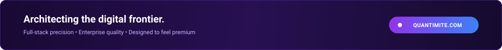



  

    

  

  

    
    
    
  

---

### Four Pillars. One Team That Ships.

<table>
  <tr>
    <td width="50%" valign="top">
      

        
        &nbsp;<b>Software Engineering &amp; Architecture</b>
      

      
Cloud-native applications, robust backend services, and scalable platforms built for long-term reliability.

      <ul>
        <li><b>Custom Web &amp; Mobile:</b> Full-stack applications &amp; cross-platform experiences</li>
        <li><b>Enterprise &amp; SaaS:</b> CRMs, ERPs, POS platforms &amp; startup MVPs</li>
        <li><b>API &amp; Cloud Infrastructure:</b> REST/GraphQL, Docker, CI/CD &amp; security audits</li>
      </ul>
    </td>
    <td width="50%" valign="top">
      

        
        &nbsp;<b>UI/UX &amp; Brand Identity Design</b>
      

      
Intuitive, high-converting interfaces and cohesive visual systems crafted with precision.

      <ul>
        <li><b>Design Systems:</b> Reusable component libraries &amp; tokens</li>
        <li><b>Product Prototyping:</b> Wireframes, interactive flows &amp; usability testing</li>
        <li><b>Brand &amp; Motion:</b> Visual identity, guidelines &amp; motion graphics</li>
      </ul>
    </td>
  </tr>
  <tr>
    <td width="50%" valign="top">
      

        
        &nbsp;<b>Digital Growth &amp; Performance</b>
      

      
Data-backed acquisition, technical search visibility, and conversion engineering.

      <ul>
        <li><b>Paid Acquisition:</b> Meta, Google &amp; LinkedIn performance campaigns</li>
        <li><b>Technical SEO:</b> Core Web Vitals, site architecture &amp; discoverability</li>
        <li><b>Lifecycle Automation:</b> Lead nurturing, email sequences &amp; funnels</li>
      </ul>
    </td>
    <td width="50%" valign="top">
      

        
        &nbsp;<b>AI &amp; Intelligent Automation</b>
      

      
Applied machine learning, autonomous agents, and workflow automation integrated into daily operations.

      <ul>
        <li><b>Custom AI Agents:</b> Domain-trained copilots &amp; RAG pipelines</li>
        <li><b>Workflow Automation:</b> Intelligent document &amp; operational routing</li>
        <li><b>Predictive Analytics:</b> Data modeling &amp; decision-support systems</li>
      </ul>
    </td>
  </tr>
</table>

---

### Why Partner With Quantimite

<table>
  <tr>
    <td width="33%" valign="top">
      <b>01 &mdash; Full-Stack Precision</b> 
      End-to-end ownership from system architecture and interface design to cloud deployment.
    </td>
    <td width="33%" valign="top">
      <b>02 &mdash; Enterprise Quality</b> 
      Rigorous code reviews, clean TypeScript/C#/Java foundations, and maintainable architecture.
    </td>
    <td width="33%" valign="top">
      <b>03 &mdash; Designed to Feel Premium</b> 
      Thoughtful typography, subtle motion, and uncluttered user journeys that build trust.
    </td>
  </tr>
</table>

---

### Core Technology Ecosystem

  
  
  
  
  
  
  
  
  
  

 

  

